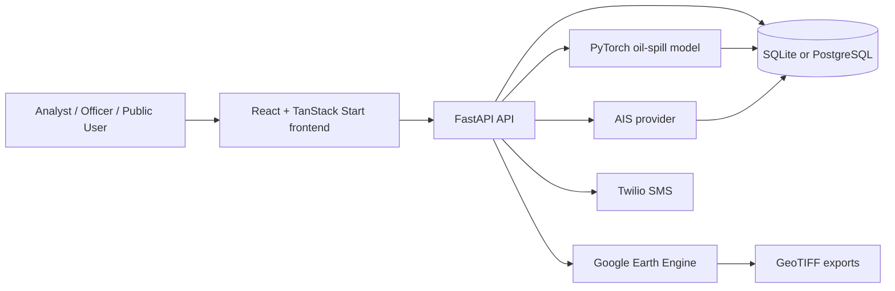

# ORICEAN

## AI-powered maritime intelligence for oil-spill investigation

ORICEAN is a full-stack maritime intelligence platform for detecting, investigating, and explaining potential oil spills. It combines satellite imagery, machine learning, geospatial drift reconstruction, vessel tracking, and operational workflows in one investigation pipeline.

The platform is designed to help analysts and monitoring officers answer:

> **Where is the spill, when did it occur, where could it have originated, and which vessels may be associated with it?**

ORICEAN is currently structured as a hackathon/MVP project with production-style separation between the frontend, API, data services, machine-learning inference, and investigation workflows.

---

## Project highlights

- Sentinel-1 SAR imagery acquisition through Google Earth Engine
- AI-assisted oil-spill detection using a PyTorch model
- Overlapping image-tile inference with configurable confidence thresholds
- Spill polygon generation and geospatial visualization
- Explainable source reconstruction using drift backtracking
- AIS-based vessel discovery, filtering, scoring, and ranking
- Evidence timelines and vessel route replay
- Analyst investigation workspace
- Monitoring officer case-review workflow
- Alert management and optional SMS delivery through Twilio
- Public incident map with restricted sensitive attribution details
- Persistent investigations and results through SQLAlchemy
- Health, model-readiness, and operational status endpoints
- Mock modes for frontend and backend development without live external services
- Responsive dark maritime-operations interface built with React and MapLibre

---

## Why ORICEAN?

Oil-spill response often requires multiple disconnected systems: satellite data portals, image-analysis scripts, vessel databases, spreadsheets, and incident-management tools. ORICEAN brings the investigation workflow together:

```text
Area of interest + date range
              |
              v
      Sentinel-1 SAR imagery
              |
              v
       ML oil-spill inference
              |
              v
       Spill polygons + scores
              |
              v
       Drift/source reconstruction
              |
              v
         AIS vessel search
              |
              v
 Explainable candidate-vessel ranking
              |
              v
 Evidence review, alerts, reports
```

The system is intended to support human decision-making. Detection and attribution results are evidence for analysts to review, not automatic legal conclusions.

---

## Features

### 1. Investigation management

Analysts can create an investigation with:

- Investigation name
- Area of interest as GeoJSON
- Start date
- End date
- Current pipeline status
- Stored ML, source-reconstruction, and attribution results
- Error and processing information

Investigation statuses include:

- `pending`
- `running_gee`
- `running_ml`
- `complete`
- `failed`

The investigation record acts as the shared object connecting every stage of the analysis.

### 2. Satellite imagery and SAR analysis

The backend integrates with Google Earth Engine for satellite-data workflows. The pipeline supports:

- Sentinel-1 SAR scene discovery
- Area-of-interest filtering
- Time-window filtering
- SAR tile generation
- GeoTIFF export
- Configurable tile stride
- Real Earth Engine mode
- Mock Earth Engine mode for local development and tests

The frontend provides map-based analysis views for reviewing satellite-derived detections and tile-level results.

### 3. AI oil-spill detection

The ML pipeline uses PyTorch and TorchVision/TIMM-compatible model components to classify SAR image tiles. The repository includes model configuration and inference code under `backend/ml`.

Inference supports:

- Configurable model path
- Configurable model architecture metadata
- CPU, CUDA, or MPS device selection
- Batched tile inference
- Confidence thresholds
- Primary and student model variants
- Positive-tile counts
- Per-tile confidence values
- Pixel statistics
- Preprocessing/debug metadata
- Optional Grad-CAM explainability output
- Merged spill detections
- Model health and metadata endpoints

When model weights are not present, the backend can attempt to download them from the configured Hugging Face repository. If the download or model load fails, the API remains available in degraded mode and reports that inference is not ready.

### 4. Spill localization and visualization

Positive tiles are represented as geospatial detections and can be merged into spill regions. The frontend visualizes:

- Spill polygons
- Detection bounds
- Confidence information
- Tile-level inspection
- SAR scene links where available
- Map legends and layer controls
- Severity and operational status

The application uses GeoJSON-compatible structures for geometry exchange between the backend and frontend.

### 5. Source reconstruction

ORICEAN estimates a probable source corridor by backtracking the detected spill using configurable drift assumptions:

- Drift lookback duration
- Assumed drift speed
- Spill geometry
- Detection/acquisition time

The result includes:

- Source corridor GeoJSON
- Release-window start and end
- Source confidence
- Reconstruction method
- Estimated drift distance
- Warnings
- Run timestamp

This is a kinematic reconstruction intended to narrow an investigation area. It does not replace oceanographic modelling or field verification.

### 6. AIS vessel attribution

The attribution pipeline searches configured AIS providers around the reconstructed source region and historical time window. Supported provider integrations include:

- Global Fishing Watch (`gfw`)
- MarineCadastre/NOAA historical AIS (`marinecadastre`)
- AISStream (`aisstream`)
- Spire (`spire`, provider availability depends on configuration)

Candidate vessels are evaluated using explainable evidence gates and weighted sub-scores:

- Spatial proximity
- Temporal consistency
- Trajectory overlap
- Time spent near the source region

Candidate records may include:

- MMSI
- Vessel name
- IMO number
- Vessel type
- Flag
- Attribution score
- Minimum distance to source
- Entry and exit timestamps
- Closest timestamp
- Number of AIS positions
- Trajectory overlap
- Time near the source
- Qualification status
- Qualification reasons
- Track points
- Score breakdown
- Evidence strings

The ranking is designed to be inspectable rather than a black-box suspect list.

### 7. Analyst workspace

The analyst experience supports:

- Investigation dashboard
- New investigation creation
- Satellite analysis
- Source reconstruction
- Vessel attribution
- Evidence timeline
- Report generation/review
- Investigation progress and status
- Detection inspection and map-based exploration

### 8. Monitoring officer workspace

The officer experience supports:

- Active and historical incident review
- Alert inbox
- Investigation summaries
- Case details
- Review checklists
- Response-state tracking
- Evidence and report review
- Printable report generation
- Vessel and source evidence review
- Operational handoff states

### 9. Alerts and SMS notifications

The backend can create alerts when significant detections are produced. Alerting includes:

- Alert listing
- Alert status
- Notification settings
- Test notification endpoint
- Configurable recipients
- Optional Twilio SMS delivery
- Delivery status tracking

Alert delivery is intentionally best-effort so a notification-provider failure does not invalidate a completed ML inference.

### 10. Public incident views

Public users can view published incident information without access to sensitive investigation data. Public views provide:

- Global incident map
- Incident list
- Incident detail pages
- Severity indicators
- Detection date and area information
- Aggregated operational status

Vessel identities, attribution evidence, and internal model scores are restricted from the public workflow.

---

## Technology stack

### Frontend

- React 19
- TypeScript
- TanStack Start
- TanStack Router
- TanStack Query
- Vite
- Tailwind CSS 4
- Radix UI primitives
- MapLibre GL
- Recharts
- React Hook Form
- Zod
- Vitest
- ESLint
- Prettier

### Backend

- Python 3.11+ recommended
- FastAPI
- Uvicorn
- Pydantic and pydantic-settings
- SQLAlchemy 2 async ORM
- SQLite with `aiosqlite` for local development
- PostgreSQL with `asyncpg` for a production-style deployment
- GeoJSON, Shapely, Rasterio
- Google Earth Engine API
- PyTorch
- TorchVision
- TIMM
- Grad-CAM
- Hugging Face Hub
- Twilio

### Data and external services

- Sentinel-1 SAR imagery through Google Earth Engine
- Google Cloud service-account authentication for Earth Engine
- Hugging Face model-weight distribution
- AIS provider APIs
- Optional Twilio SMS alerting

---

## Architecture



### Backend layers

```text
backend/
├── app/
│   ├── api/          HTTP routers and response envelopes
│   ├── core/         settings and application configuration
│   ├── db/           async SQLAlchemy engine and sessions
│   ├── models/       database models
│   ├── schemas/      Pydantic request/response models
│   └── services/     Earth Engine, ML, drift, AIS, alerts, and case logic
├── ml/
│   ├── inference/    predictor and inference orchestration
│   ├── models/       model metadata/configuration and local weights
│   ├── preprocessing/
│   └── notebooks/
├── tests/
├── create_tables.py
├── requirements.txt
└── .env
```

### Frontend layers

```text
frontend/
├── src/
│   ├── components/
│   │   ├── oricean/   ORICEAN workflow, map, alert, and report components
│   │   └── ui/        reusable UI primitives
│   ├── lib/
│   │   ├── api.ts     typed API client and domain types
│   │   ├── session.tsx
│   │   └── investigation-store.tsx
│   ├── routes/        TanStack file-based routes
│   ├── router.tsx
│   ├── server.ts
│   └── styles.css
├── package.json
├── vite.config.ts
└── vitest.config.ts
```

> The actual source directory is `frontend/src/components/oricean/`; the spacing in the tree above is only typographic.

---

## API overview

The API uses a consistent response envelope:

```json
{
  "data": {}
}
```

Errors use:

```json
{
  "error": "Error name",
  "detail": "Human-readable explanation"
}
```

### System endpoints

| Method | Endpoint | Purpose |
| --- | --- | --- |
| `GET` | `/` | API welcome/status response |
| `GET` | `/health` | Backend health and dependency state |
| `GET` | `/docs` | Swagger/OpenAPI documentation |
| `GET` | `/redoc` | ReDoc API documentation |

### Investigation endpoints

| Method | Endpoint | Purpose |
| --- | --- | --- |
| `POST` | `/api/investigations/` | Create an investigation |
| `GET` | `/api/investigations/` | List investigations |
| `GET` | `/api/investigations/{id}` | Get an investigation |
| `PATCH` | `/api/investigations/{id}` | Update investigation state/details |
| `DELETE` | `/api/investigations/{id}` | Delete an investigation |

### Machine-learning endpoints

| Method | Endpoint | Purpose |
| --- | --- | --- |
| `POST` | `/api/ml/run-inference` | Run SAR oil-spill inference |
| `GET` | `/api/ml/health` | Report model readiness |
| `GET` | `/api/ml/model-info` | Return model metadata |

### Source and attribution endpoints

| Method | Endpoint | Purpose |
| --- | --- | --- |
| `POST` | `/api/source/reconstruct` | Compute a probable source corridor |
| `POST` | `/api/attribution/run` | Query and rank candidate vessels |
| `GET` | `/api/attribution/{investigation_id}` | Retrieve stored attribution results |

### Alerts, officer, and public endpoints

| Method | Endpoint | Purpose |
| --- | --- | --- |
| `GET` | `/api/alerts` | List alerts |
| `GET` | `/api/alerts/status` | Get alerting status |
| `GET` | `/api/alerts/settings` | Read notification settings |
| `PUT` | `/api/alerts/settings` | Update notification settings |
| `POST` | `/api/alerts/test` | Send/test an alert |
| `GET` | `/api/public/incidents` | List published incidents |
| `GET` | `/api/public/incidents/{incident_id}` | Get a published incident |
| `GET` | `/api/officer/cases` | List officer cases |
| `GET` | `/api/officer/cases/{investigation_id}` | Get an officer case |
| `PATCH` | `/api/officer/cases/{investigation_id}` | Update officer case state |

For the authoritative request and response schemas, run the backend and open `/docs`.

---

## Prerequisites

Install the following before running the project:

- Git
- Node.js 20+ recommended
- npm (or Bun, if preferred)
- Python 3.11+ recommended
- A C/C++ build environment may be required by some scientific Python packages
- Google Earth Engine project/service-account credentials for live satellite workflows
- AIS provider credentials for live vessel attribution
- Twilio credentials only if SMS alerts are required

The ML dependencies can be large. A CPU-only development environment is supported, but inference will be slower than on a CUDA-enabled machine.

---

## Local setup

### 1. Clone the repository

```bash
git clone https://github.com/<your-username>/<your-repository>.git
cd <your-repository>
```

### 2. Configure the backend

Create a virtual environment:

```bash
cd backend
python -m venv .venv
```

Activate it:

**Windows PowerShell**

```powershell
.\.venv\Scripts\Activate.ps1
```

**macOS/Linux**

```bash
source .venv/bin/activate
```

Install dependencies:

```bash
python -m pip install --upgrade pip
pip install -r requirements.txt
```

Create `backend/.env` from the template below and update values for your environment.

### 3. Backend environment configuration

```dotenv
# Local SQLite development database
DATABASE_URL=sqlite+aiosqlite:///./oricean.db

# Model configuration
MODEL_PATH=ml/models/sar_oil_slick_detection/model.pth
MODEL_CONFIG_PATH=ml/models/sar_oil_slick_detection/config.json
GEOTIFF_EXPORT_DIR=./exports
INFERENCE_DEVICE=cpu

# Set true when external services are unavailable
GEE_MOCK_MODE=true
ML_MOCK_MODE=true

# Frontend origin
FRONTEND_ORIGIN=http://localhost:5173

# Google Earth Engine; required when GEE_MOCK_MODE=false
GOOGLE_APPLICATION_CREDENTIALS=C:/secure/path/gee-service-account.json
GEE_PROJECT_ID=your-earth-engine-project-id

# AIS; leave provider empty to disable live attribution
AIS_PROVIDER=
AIS_API_KEY=
GFW_API_TOKEN=

# Optional Twilio alerting
ALERT_ENABLED=false
TWILIO_ACCOUNT_SID=
TWILIO_AUTH_TOKEN=
TWILIO_FROM_NUMBER=
ALERT_RECIPIENTS=
```

Never commit real credentials, service-account JSON files, access tokens, or `.env` files.

### 4. Initialize the database

The application creates required tables during startup. To initialize explicitly:

```bash
python create_tables.py
```

### 5. Start the backend

From `backend/`:

```bash
uvicorn app.main:app --reload --host 0.0.0.0 --port 8010
```

The backend will be available at:

- API: <http://localhost:8010>
- Swagger UI: <http://localhost:8010/docs>
- ReDoc: <http://localhost:8010/redoc>
- Health: <http://localhost:8010/health>

### 6. Start the frontend

Open a second terminal:

```bash
cd frontend
npm install
```

Create `frontend/.env.local` if the backend is not running at the default URL:

```dotenv
VITE_API_BASE_URL=http://localhost:8010
```

Start the development server:

```bash
npm run dev
```

The frontend normally runs at <http://localhost:5173>.

---

## Development modes

### Fully mocked local demo

Use this mode when you want to demonstrate the UI without Google Earth Engine, AIS, or a local model:

```dotenv
GEE_MOCK_MODE=true
ML_MOCK_MODE=true
AIS_PROVIDER=
ALERT_ENABLED=false
```

This is useful for frontend development and demonstrations, but results are synthetic and must not be presented as real environmental evidence.

### Live satellite and ML mode

```dotenv
GEE_MOCK_MODE=false
ML_MOCK_MODE=false
GOOGLE_APPLICATION_CREDENTIALS=C:/secure/path/gee-service-account.json
GEE_PROJECT_ID=your-earth-engine-project-id
MODEL_PATH=ml/models/sar_oil_slick_detection/model.pth
```

Confirm that:

- The service-account file exists and is readable
- The Earth Engine project is enabled and authorized
- Model weights are present or downloadable
- The configured model path is correct

### Live AIS attribution

Set the provider and credentials appropriate to your data source:

```dotenv
AIS_PROVIDER=gfw
GFW_API_TOKEN=your-token
```

AIS queries can download or process large historical datasets. Use a restricted area and date range during development.

---

## Frontend commands

Run from `frontend/`:

```bash
npm run dev        # Start Vite/TanStack development server
npm run build      # Create a production build
npm run build:dev  # Build using development mode
npm run preview    # Preview the production build
npm run lint       # Run ESLint
npm run format     # Format source files with Prettier
npm test           # Run Vitest once
npm run test:watch # Run Vitest in watch mode
npm run test:ui    # Open the Vitest UI
```

---

## Backend testing

Run from `backend/` with the virtual environment activated:

```bash
pytest
```

The backend test suite covers API behavior, integration paths, ML behavior, officer workflows, source reconstruction, and related service logic. Some tests may require mock mode or local test data depending on the selected test.

Before opening a pull request, run:

```bash
pytest
```

and:

```bash
cd ../frontend
npm run lint
npm test
npm run build
```

---

## Model and data files

The repository may contain large local artifacts such as:

- PyTorch model weights
- SQLite database files
- Training notebooks
- GeoTIFF exports
- Training and validation plots
- Confusion matrices

Model weights and credentials should not be committed to a public GitHub repository unless you have verified their licensing and size. The backend can download the primary model from Hugging Face when configured.

The recommended GitHub approach is:

1. Track model configuration and metadata.
2. Ignore downloaded weights and generated exports.
3. Document the model source and expected path.
4. Use Git LFS or an external model registry for large artifacts when redistribution is permitted.
5. Remove or rotate any credentials before the first public push.

---

## Security and privacy checklist before publishing

Run this checklist before pushing the project to GitHub:

- Remove all real `.env` files from the commit.
- Confirm service-account JSON files are ignored and untracked.
- Rotate any exposed Google, Hugging Face, AIS, or Twilio credentials.
- Remove local databases if they contain sensitive investigation records.
- Review model weights and training data licenses.
- Review screenshots for coordinates, vessel identities, phone numbers, and tokens.
- Check `git status` and `git diff --cached` before committing.
- Search the repository for secrets:

```bash
git grep -n -I -E "(API_KEY|TOKEN|SECRET|PASSWORD|PRIVATE_KEY|BEGIN .* PRIVATE KEY)"
```

The `.gitignore` files are intended to exclude common secrets, virtual environments, Node dependencies, generated files, AIS caches, and downloaded model weights. Always verify the final Git index manually.

---

## Project structure

```text
ORICEAN/
├── backend/
│   ├── app/
│   │   ├── api/
│   │   │   ├── alerts.py
│   │   │   ├── attribution.py
│   │   │   ├── investigations.py
│   │   │   ├── ml.py
│   │   │   ├── officer.py
│   │   │   ├── public.py
│   │   │   ├── satellite.py
│   │   │   └── source.py
│   │   ├── core/config.py
│   │   ├── db/database.py
│   │   ├── models/
│   │   ├── schemas/
│   │   └── services/
│   ├── ml/
│   │   ├── inference/predictor.py
│   │   ├── models/
│   │   ├── preprocessing/
│   │   └── notebooks/
│   ├── tests/
│   ├── create_tables.py
│   ├── requirements.txt
│   └── .env              # local file; do not commit
├── frontend/
│   ├── src/
│   │   ├── components/
│   │   ├── lib/api.ts
│   │   ├── routes/
│   │   ├── router.tsx
│   │   └── styles.css
│   ├── public/
│   ├── package.json
│   └── vite.config.ts
├── exports/
├── files/
├── .kiro/
├── build.md
└── README.md
```

`routeTree.gen.ts` is generated by TanStack Router and should not be edited manually.

---

## Design principles

- **Evidence first:** show the data, score breakdown, and qualification reasons behind a result.
- **Human review:** preserve analyst and officer control over decisions.
- **Graceful degradation:** expose health state and warnings instead of silently returning false confidence.
- **Modular services:** keep satellite, ML, drift, AIS, alert, and case logic independently testable.
- **Simple infrastructure:** optimize for a reliable end-to-end MVP before adding distributed infrastructure.
- **Restricted sensitive data:** keep vessel attribution and internal evidence out of public views.
- **Reproducibility:** persist the investigation inputs, outputs, timestamps, model information, and warnings.

---

## Known limitations

- Live Earth Engine, AIS, and SMS workflows require external credentials and service availability.
- ML accuracy depends on training data, preprocessing, model weights, and SAR scene conditions.
- Drift reconstruction uses configurable assumptions and is not a full physical ocean model.
- AIS coverage varies by geography, vessel, provider, signal availability, and historical retention.
- Attribution scores are decision-support evidence, not proof of liability.
- Large model weights and historical AIS files can make installation and inference resource-intensive.
- Authentication and authorization should be strengthened before production deployment.
- The current project is an MVP and should undergo operational, privacy, and security review before handling real incidents.

---

## Roadmap ideas

- Add production authentication and role-based authorization
- Add background job processing for long-running GEE and AIS operations
- Add experiment tracking and model version registry
- Add ocean-current and wind-aware drift modelling
- Add additional satellite sources and multi-sensor fusion
- Add stronger provenance and immutable evidence records
- Add automated model evaluation dashboards
- Add containerized deployment and CI/CD
- Add observability, metrics, tracing, and structured audit logs
- Add data-retention and privacy controls
- Add end-to-end deployment documentation for a hosted environment

---

## Contributing

1. Create a feature branch.
2. Keep secrets and generated artifacts out of commits.
3. Add or update tests for behavior changes.
4. Keep API response envelopes and typed frontend contracts consistent.
5. Run backend tests, frontend linting, frontend tests, and the production build.
6. Explain external-service requirements in the pull request.
7. Keep changes focused and document any configuration changes.

Suggested workflow:

```bash
git checkout -b feature/your-change

# Make changes
# Run tests and checks

git add .
git diff --cached
git commit -m "Describe the change"
git push -u origin feature/your-change
```

---

## License

No license file is currently defined in the repository. Before publishing ORICEAN publicly, add a license that matches the ownership and licensing terms of:

- Application source code
- Training data
- Satellite data
- AIS data
- Model architecture and weights
- Third-party UI and mapping libraries

Until a license is added, normal copyright restrictions apply.

---


